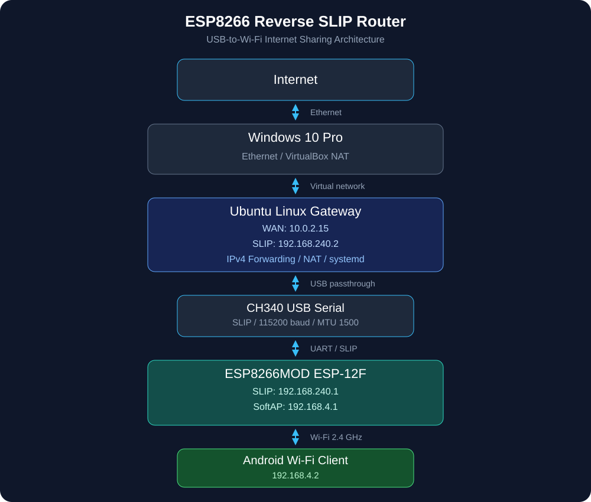
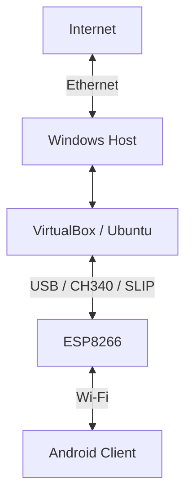

# ESP8266 Reverse SLIP Router

An ESP8266-based USB-to-Wi-Fi router with corrected IPv4 routing
and automated Linux gateway configuration using systemd.

Based on the original ESP SLIP Router by Martin Ger.

## Overview

This fork addresses an AP-mode routing issue encountered when
sharing an Ethernet internet connection from a Linux host
with wireless clients through a serial SLIP connection.

## Key improvements

- Corrected default network interface selection after SDK initialization.
- Extended network interface diagnostics.
- Explicit UART configuration during Linux startup.
- Automated SLIP interface configuration.
- IPv4 forwarding and NAT configuration on Linux.
- Configurable serial device, baud rate and WAN interface.
- Automatic startup using systemd.
- Interactive Linux installation script.

## System architecture






## Hardware

- ESP8266MOD ESP-12F
- ESP8266EX microcontroller
- 4 MB flash memory
- CH340 USB-to-serial converter
- Linux computer or virtual machine
- Wi-Fi client device

## Network configuration

| Interface | Address |
|---|---|
| Linux SLIP interface | 192.168.240.2 |
| ESP8266 SLIP interface | 192.168.240.1 |
| ESP8266 SoftAP | 192.168.4.1 |
| Wireless network | 192.168.4.0/24 |
| DNS server used in testing | 1.1.1.1 |
| UART speed | 115200 baud |
| MTU | 1500 bytes |

NAT is performed on the Linux host rather than on the ESP8266
in the tested reverse-routing configuration.

## Linux installation

Install the required packages on Debian or Ubuntu:

```bash
sudo apt install net-tools iproute2 iptables
```

Flash the ESP8266 firmware, connect the serial adapter and make
sure no other process is using the serial port.

Run the interactive installer:

```bash
sudo bash linux/install.sh
```

The installer asks for the serial device, WAN interface and baud rate.

It installs the router script and systemd service and enables
automatic startup.

Review the configuration before starting the service.
The installer requires root privileges and modifies network
forwarding and firewall settings.

## ESP8266 configuration

With the SLIP connection established, connect to the firmware console:

```bash
nc 192.168.240.1 7777
```

Configure AP mode using the following console commands:

```text
set ap_ssid YOUR_SSID
set ap_password YOUR_PASSWORD
set ap_open 0
set use_ap 1
set dns 1.1.1.1
save
reset
```

Use a strong Wi-Fi password. The TCP configuration console
should only be exposed to trusted networks.

## Service management

Check the router status:

```bash
sudo systemctl status esp-slip-router
```

Start the router:

```bash
sudo systemctl start esp-slip-router
```

Stop the router:

```bash
sudo systemctl stop esp-slip-router
```

Restart the router:

```bash
sudo systemctl restart esp-slip-router
```

Monitor service logs:

```bash
sudo journalctl -u esp-slip-router -f
```

## Firmware routing fix

In AP mode, the SDK was overriding the default network interface
during initialization in the tested environment.

The following callback was added to user/user_main.c:

```c
static void ICACHE_FLASH_ATTR router_init_done(void)
{
    if (config.use_ap) {
        netif_set_default(&sl_netif);
    }
}
```

The callback is registered at the end of user_init():

```c
system_init_done_cb(router_init_done);
```

This ensures that the SLIP interface becomes the default
network interface after SDK initialization.

## Experimental results

The prototype was tested in November 2026 using an ESP-12F,
a CH340 serial adapter, Ubuntu running in VirtualBox,
Windows 10 Pro and an Android smartphone.

| Parameter | Result |
|---|---|
| ICMP packets transmitted | 10 |
| ICMP packets received | 10 |
| Packet loss | 0% |
| Minimum RTT | 18.225 ms |
| Average RTT | 20.174 ms |
| Maximum RTT | 29.745 ms |
| RTT standard deviation | 3.785 ms |
| Internet access | Successful |
| DNS resolution | Successful |
| HTTPS navigation | Successful |
| Automatic startup after reboot | Successful |

These results refer to the working prototype.

The cleaned firmware has been successfully compiled.
The generalized Linux scripts have passed syntax checks.
Hardware validation of the cleaned firmware and functional
testing of the new installer remain pending.

## Troubleshooting

If the service is running but the ESP8266 is unreachable,
check the serial configuration:

```bash
sudo stty -F /dev/ttyUSB0 -a
```

Replace the device path if necessary.

During testing, the serial port reported 0 baud after reboot,
and invalid IP packets were observed using tcpdump.

Explicit UART configuration with stty before starting
slattach resolved the observed startup problem.

Verify the SLIP connection:

```bash
ping -c 10 192.168.240.1
```

## Limitations

- UART bandwidth is the main performance bottleneck.
- At 115200 baud with 8N1 framing, the theoretical maximum
  is 92.16 kbps or 11.52 kB/s before protocol overhead.
- Actual internet throughput has not yet been measured.
- Long-term stability and multiple-client testing remain pending.
- Physical USB reconnection has not yet been validated.
- The Linux host must remain operational.
- VirtualBox users must ensure USB passthrough is enabled.
- The Linux scripts assume the default SLIP and SoftAP subnets.
- Existing firewall rules may require additional configuration.

## Credits

**Original project:** Martin Ger

https://github.com/martin-ger/esp_slip_router

**Reverse-routing corrections, Linux automation and
experimental validation:** Eliton Machado

Tomsk Polytechnic University (TPU)

November 2026

## References

- https://www.rfc-editor.org/rfc/rfc1055
- https://github.com/martin-ger/esp_slip_router
- https://github.com/martin-ger/esp-open-lwip
- https://github.com/pfalcon/esp-open-sdk
- https://github.com/martin-ger/esp_slip_router/issues/15

---

# Original upstream documentation

The following section preserves the original project documentation
for reference. Its original NAT behavior and speed estimates
should not be confused with the reverse-routing configuration
and corrected bandwidth calculation described above.

---

# esp_slip_router
A SLIP to WiFi router

This is an implementation of a SLIP (Serial Line IP - RFC1055) router on the ESP8266. It can be used as simple (and slow) network interface to get WiFi connectivity. The ESP can act as STA or as AP. It transparently forwards any IP traffic through it. As it uses NAT no routing entries are required on the other side.

UPDATE: If you are experiencing DNS-issues or if you are looking for a dockerized build-environment have a look here: https://github.com/e1z0/esp_slip_router

# Usage as STA
In this mode the ESP connects to the internet via an AP with ssid, password and offers at UART0 a SLIP interface with IP address 192.168.240.1. This default can be changed in the file user_config.h. 

To connect a Linux-based host, start the firmware on the ESP, connect it via serial to USB, and use the following commands on the host:
```
sudo slattach -L -p slip -s 115200 /dev/ttyUSB0&
sudo ifconfig sl0 192.168.240.2 pointopoint 192.168.240.1 up mtu 1500
```
now 
```
telnet 192.168.240.1 7777
```
gives you terminal access to the esp as router. On the ESP you then enter:

```
CMD>set ssid <your_ssid> 
CMD>set password <your_pw> 
CMD>set use_ap 0
CMD>save
CMD>reset
```

To get full internet access you will need aditionally a route:
```
sudo route add default gw 192.168.240.1
```
and a DNS server - add an appropriate entry (e.g. public DNS server) in /etc/resolv.conf, eg. by (as root):
```
echo "nameserver 9.9.9.9" > /etc/resolv.conf
```
A script may help to automize this process.

The status LED (default: GPIO2) indicates:
- permanently on: not connected (initial state after boot)
- permanently off: connected (or SoftAP active), no traffic
- rapidly blinking: in- or outgoing traffic

The default config of the router can be overwritten and persistenly saved to flash by using a console interface. This console is available via tcp port 7777 (e.g. from the host attached to the serial line - see above). 

The console understands the following command:
- help: prints a short help message
- show [stats]: prints the current config and status
- set ssid|pasword [value]: changes the named config parameter
- set addr [ip-addr]: sets the IP address of the SLIP interface (default: 192.168.240.1)
- set speed [80|160]: sets the CPU clock frequency (default: 160)
- set bitrate [bitrate]: sets the serial bitrate to a new value
- portmap add [TCP|UDP] _external_port_ _internal_ip_ _internal_port_: adds a port forwarding (works in STA mode)
- portmap remove [TCP|UDP] _external_port_: deletes a port forwarding
- save: saves the current parameters to flash
- quit: terminates a remote session
- reset [factory]: resets the esp and applies the config, optionally resets WiFi params to default values
- lock: locks the current config, changes are not allowed
- unlock [password]: unlocks the config, requires password of the network AP
- scan: does a scan for APs

If you want to enter non-ASCII or special characters you can use HTTP-style hex encoding (e.g. "My%20AccessPoint") or, only on the CLI, as shortcut C-style quotes with backslash (e.g. "My\ AccessPoint"). Both methods will result in a string "My AccessPoint".

# Usage as AP
You can also turn the sides and make the ESP to work as AP - useful e.g. if you want to connect other devices to a RasPi that has no WiFi interface:

With a Linux-based host start the firmware on the esp, connect it via serial to USB, and use the following commands on the host:
```
sudo slattach -L -p slip -s 115200 /dev/ttyUSB0&
sudo ifconfig sl0 192.168.240.2 pointopoint 192.168.240.1 up mtu 1500
sudo route add -net 192.168.4.0/24 gw 192.168.240.1
```
again 
```
telnet 192.168.240.1 7777
```
gives you terminal access to the ESP as router. On the ESP you then enter:

```
CMD>set ap_ssid <your_ssid> 
CMD>set ap_password <your_pw> 
CMD>set use_ap 1
CMD>save
CMD>reset
```

Now STAs of this AP get IP adresses in the 192.168.4.0/24 network and can reach the Linux machine as "192.168.240.2". The AP interface is NATed, i.e. you cannot set up connections from the Linux machine to the STAs, but from STAs to Linux works. Useful e.g. if you want to reach an MQTT server on the Linux.

The console understands the following command for the AP mode:
- set use_ap [0|1]: selects, whether the esp_slip_router uses an STA interface (use_ap = 0, default) or an AP interface (use_ap = 1)
- set [ap_ssid|ap_password] _value_: changes the settings for the soft-AP of the ESP (for your stations)
- set ap_channel [1-13]: sets the channel of the SoftAP (default 1)
- set ap_open [0|1]: selects, whether the soft-AP uses WPA2-PSK security (ap_open=0,  automatic, if an ap_password is set) or open (ap_open=1)
- set ssid_hidden [0|1]: selects, whether the SSID of the soft-AP is hidden (ssid_hidden=1) or visible (ssid_hidden=0, default)
- set max_clients [1-8]: sets the number of STAs that can connct to the SoftAP (limit of the ESP's SoftAP implementation is 8, default)
- set addr_peer [ip-addr]: sets the IP address of the peer of the SLIP interface that is also the default gateway (default: 192.168.240.2)
- set dns [ip-addr]: sets the IP address of the DNS server that is distributed via DHCP (default: 192.168.240.2)

# Hayes-compatible Modem Mode

There is an option to have the SLIP router act as a Hayes-compatible modem, enabling you to use it as a modem on, for example, early Windows releases as a serial modem (with an appropriate transciever).

To use this, simply uncomment `#define ENABLE_HAYES 1` in the `user/user_config.h` file. The modem can be configured to boot up into an already-dialled state by uncommenting `#define HAYES_CMD_MODE_AT_BOOT true` and changing `true` to `false`.

# Building and Flashing
To build this binary you download and install the esp-open-sdk (https://github.com/pfalcon/esp-open-sdk). The software was developed and tested usinfg NONOS SDK v2.2. Make sure, you can compile and download the included "blinky" example.

Then download this source tree in a separate directory and adjust the BUILD_AREA variable in the Makefile and any desired options in user/user_config.h. Build the esp_wifi_repeater firmware with "make". "make flash" flashes it onto an esp8266.

The source tree includes a binary version of the liblwip_open plus the required additional includes from my fork of esp-open-lwip. *No additional install action is required for that.* Only if you don't want to use the precompiled library, checkout the sources from https://github.com/martin-ger/esp-open-lwip . Use it to replace the directory "esp-open-lwip" in the esp-open-sdk tree. "make clean" in the esp_open_lwip dir and once again a "make" in the upper esp_open_sdk directory. This will compile a liblwip_open.a that contains the NAT-features. Replace liblwip_open_napt.a with that binary.

If you want to use the precompiled binaries you can flash them with "esptool.py --port /dev/ttyUSB0 write_flash -fs 32m 0x00000 firmware/0x00000.bin 0x10000 firmware/0x10000.bin" (use -fs 8m for an ESP-01)

## Building with Docker
If you don't want to install the esp-open-sdk yourself (it is hard to build on current Linux distributions), you can use the prebuilt Docker image martinfger/iot_devel:1.0 that contains the complete build environment. With the ESP8266 connected to /dev/ttyUSB0:
```
git clone https://github.com/martin-ger/esp_slip_router.git
docker run -it --rm --device=/dev/ttyUSB0 -v $(pwd)/esp_slip_router:/home/esp/esp_slip_router martinfger/iot_devel:1.0
cd esp_slip_router
make
make flash
```
If your serial adapter has a different name (e.g. /dev/ttyACM0), adjust the --device option. To build only, omit --device; the binaries end up in the firmware/ directory on the host.

# Softuart UART
As UART0, the HW UART of the esp8266 is busy with the SLIP protocoll, it cannot be used simultaniuosly as debugging output. This is highly uncomfortable especially during development. If you define DEBUG_SOFTUART in user_config.h, a second UART will be simulated in software (Rx GPIO 14, Tx GPIO 12, 19200 baud). All debug output (os_printf) will then be redirectd to this port.

# Known Issues
- Speed: 115200 is the max baudrate on many USB ports and the current standard speed. This is SLOW compared to the typical WiFi speeds. This means connectivity via the serial line works, even basic web browsing, but the speed is what you can expect from about 100kB/s... But IoT applications typically use much less bandwidth, also terminal access is fine.
- A configuration to enable hardware flow control (RTS/CTS) is available in include/driver/uart.h. It has been recompiled with UART_HW_RTS 1 and UART_HW_CTS 1 (https://github.com/martin-ger/esp_slip_router/issues/16#issuecomment-617807229). In that case slattach does not work anymore with it, even with removing the -L argument, however it does work in the Amiga with hardware flow control enabled (known to work with up to 57600 bauds). See issue #16.
- If you are just interested in the SLIP interface as a basis for you own projects, you might have a look into the user_simple directory. It contains a minimal version of the router with no config console.
