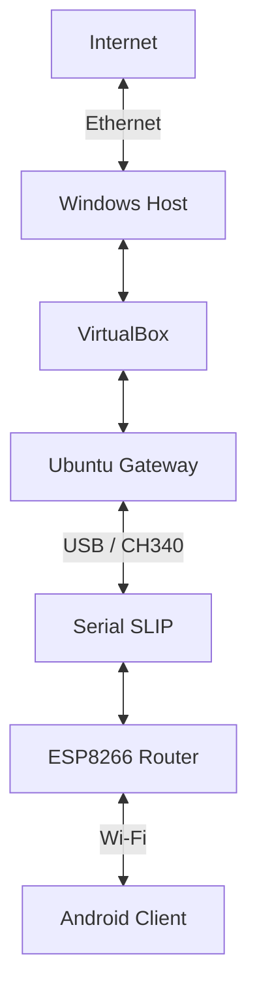

# Technical Report

## Implementation and Experimental Validation of an
## Automated ESP8266-Based USB-to-Wi-Fi SLIP Router

**Author:** Eliton Machado  
**Institution:** Tomsk Polytechnic University (TPU)  
**Development period:** November 20–26, 2026  
**Original firmware developer:** Martin Ger  
**Project status:** Functional proof of concept  

---

## Abstract

This project presents the implementation, adaptation,
and experimental validation of an ESP8266-based router
capable of sharing an Ethernet internet connection from
a computer with wireless client devices through a USB
serial interface.

The Serial Line Internet Protocol (SLIP) was employed
to transport IPv4 packets between the ESP8266 and a
Linux-based gateway.

Initial experiments conducted under Windows revealed
difficulties involving virtual network interfaces,
serial communication integration, and network address
translation.

The implementation was subsequently migrated to Ubuntu
running inside an Oracle VirtualBox virtual machine.

Several technical problems were identified during
development, including incorrect default network
interface selection, redundant NAT initialization,
insufficient interface MTU, and incorrect UART
configuration after system reboot.

The primary routing problem was resolved by registering
a post-initialization callback that assigns the SLIP
interface as the default network interface after the
ESP8266 SDK completes its initialization.

Linux gateway configuration was subsequently automated
using Bash and systemd.

Experimental validation demonstrated successful internet
access, DNS resolution, HTTPS navigation, and automatic
operation following a Linux reboot.

A final ICMP experiment produced zero packet loss and
an average round-trip latency of 20.174 ms.

**Keywords:** ESP8266, SLIP, IPv4, UART, lwIP, NAT,
embedded systems, Linux, systemd, network routing.

---

## 1. Introduction

Wireless connectivity is an essential component of
modern computing and embedded systems.

However, certain computers and specialized devices
may lack an available wireless network interface.

The ESP8266 provides an inexpensive platform for
implementing alternative wireless communication
architectures.

The original ESP SLIP Router developed by Martin Ger
supports communication between a serial interface
and a wireless network.

This project investigates the reverse configuration,
in which the computer provides internet connectivity
and the ESP8266 operates as a wireless access point.

The work focuses on identifying and resolving routing
and initialization problems encountered in this
configuration.

## 2. Project Objectives

### 2.1 Primary objective

Implement a functional USB-to-Wi-Fi internet sharing
system using an ESP8266 microcontroller and a
Linux-based gateway.

### 2.2 Specific objectives

- Establish bidirectional serial communication.
- Implement IPv4 packet transport using SLIP.
- Configure the ESP8266 as a wireless access point.
- Enable IPv4 forwarding on the Linux gateway.
- Configure network address translation.
- Investigate firmware-level routing behavior.
- Identify and resolve initialization problems.
- Automate the gateway configuration.
- Experimentally validate the resulting system.

## 3. Hardware and Software

### 3.1 Hardware

| Component | Specification |
|---|---|
| Microcontroller | ESP8266EX |
| Module | ESP8266MOD ESP-12F |
| Flash memory | 4 MB |
| CPU frequency | 160 MHz |
| Crystal frequency | 26 MHz |
| Serial adapter | CH340 |
| UART configuration | 115200 baud, 8N1 |
| Wireless client | Android smartphone |

### 3.2 Software

| Component | Specification |
|---|---|
| Host operating system | Windows 10 Pro |
| Virtualization platform | Oracle VirtualBox |
| Guest operating system | Ubuntu Linux |
| Firmware | ESP SLIP Router V1.1.1 |
| Network stack | lwIP |
| Development environment | esp-open-sdk |
| Cross-compiler | Xtensa GCC 4.8.5 |
| Flashing utility | Esptool 4.7.0 |
| Serial protocol | SLIP |
| Network protocol | IPv4 |
| Automation | Bash and systemd |

## 4. System Architecture

The Linux virtual machine acts as the internet gateway.

The ESP8266 forwards wireless client traffic through
its serial interface, while Linux performs IP
forwarding and network address translation.



### 4.1 Network addressing

| Interface | IPv4 address |
|---|---|
| VirtualBox gateway | 10.0.2.2 |
| Ubuntu Ethernet | 10.0.2.15 |
| Ubuntu SLIP | 192.168.240.2 |
| ESP8266 SLIP | 192.168.240.1 |
| ESP8266 SoftAP | 192.168.4.1 |
| Android client during testing | 192.168.4.2 |
| DNS server | 1.1.1.1 |

The Linux gateway requires a return route to the
192.168.4.0/24 wireless network through the ESP8266.

## 5. Theoretical Background

### 5.1 Serial Line Internet Protocol

SLIP is a protocol for transmitting IP datagrams
over serial communication links.

It is described in RFC 1055.

The protocol uses special characters to identify
packet boundaries and escape reserved byte values.

| Character | Hexadecimal value |
|---|---|
| END | 0xC0 |
| ESC | 0xDB |
| ESC_END | 0xDC |
| ESC_ESC | 0xDD |

An initial Python experiment verified the encoding
and decoding of a test byte sequence.

```text
Original:     4500c0db01020304
Encoded:      c04500dbdcdbdd01020304c0
Decoded:      4500c0db01020304

SLIP TEST: SUCCESS
```

The original byte sequence was successfully recovered
after the encoding and decoding operations.

### 5.2 IPv4 forwarding

IP forwarding allows a network device to receive
packets from one interface and transmit them through
another interface according to routing information.

Both the ESP8266 and Linux gateway participate in
this process.

### 5.3 Network address translation

Network address translation allows clients using
private IP addresses to access external networks.

In the final tested configuration, Linux performs
NAT using iptables masquerading.

The ESP8266 does not require active NAT in this
reverse-routing architecture.

## 6. Development Methodology

The development process employed incremental
implementation, hypothesis testing, packet analysis,
source-code inspection, firmware instrumentation,
and experimental validation.

The main development stages were:

1. Initial ESP8266 communication tests.
2. Experimental SLIP implementation under Windows.
3. Migration to a virtualized Linux environment.
4. Embedded toolchain compilation.
5. Firmware compilation and flashing.
6. Serial interface configuration.
7. IPv4 routing and NAT configuration.
8. Network troubleshooting.
9. Analysis of compiled lwIP routines.
10. Firmware routing correction.
11. Linux gateway automation.
12. Reboot validation.

## 7. Initial Windows Implementation

Initial development was conducted using Windows 10 Pro.

Arduino IDE, Python, PySerial, PowerShell, and
virtual TAP network interfaces were investigated.

Serial communication through COM6 was successfully
established.

An experimental IPv4 packet was transmitted to the
ESP8266, and a 20-byte IPv4 response was received.

However, the selected Windows NAT configuration
procedure encountered an unavailable MSFT_NetNat
management class.

The reported error included:

```text
HRESULT: 0x80041002
```

Integration between the serial connection, TAP
interface, and Windows routing system remained
unsuccessful.

These difficulties motivated migration to Linux,
where native SLIP support was available.

## 8. Linux Development Environment

Ubuntu was installed inside Oracle VirtualBox.

The CH340 serial adapter was passed directly to the
virtual machine using USB passthrough.

The Linux kernel identified the adapter through
the ch341 USB serial driver.

The device was assigned either /dev/ttyUSB0 or
/dev/ttyUSB1 following different reconnections.

A persistent device path was subsequently identified:

```text
/dev/serial/by-id/usb-1a86_USB_Serial-if00-port0
```

This persistent identifier was used in the automation
script to avoid dependence on changing device numbers.

## 9. Firmware Development

The original ESP SLIP Router source code was obtained
from:

https://github.com/martin-ger/esp_slip_router

The esp-open-sdk environment was compiled using the
Xtensa GCC 4.8.5 cross-compiler.

Compatibility problems involving older toolchain
components and newer Linux tools were encountered
during compilation.

After addressing these issues, firmware compilation
was completed successfully.

The firmware was generated as two binary segments:

```text
firmware/0x00000.bin
firmware/0x10000.bin
```

A successful prototype firmware build contained:

| Segment | Size |
|---|---:|
| 0x00000.bin | 35,296 bytes |
| 0x10000.bin | 231,940 bytes |
| Total | 267,236 bytes |

These sizes refer to the tested prototype build,
not necessarily the later cleaned release binaries.

## 10. Linux Gateway Configuration

The SLIP connection was established using:

```bash
sudo slattach -L -p slip -s 115200 /dev/ttyUSB0
```

The host interface was configured using:

```bash
sudo ip addr add 192.168.240.2 \
    peer 192.168.240.1 dev sl0

sudo ip link set dev sl0 mtu 1500 up
```

The return route was configured using:

```bash
sudo ip route replace 192.168.4.0/24 \
    via 192.168.240.1 dev sl0
```

IPv4 forwarding was enabled:

```bash
sudo sysctl -w net.ipv4.ip_forward=1
```

The working prototype used masquerading on the
external network interface:

```bash
sudo iptables -t nat -A POSTROUTING \
    -o enp0s3 -j MASQUERADE
```

The publication version restricts this NAT rule
to the ESP8266 wireless subnet:

```bash
sudo iptables -t nat -A POSTROUTING \
    -s 192.168.4.0/24 -o enp0s3 -j MASQUERADE
```

The generalized publication configuration has not
yet undergone a separate complete hardware test.

## 11. Technical Problems and Solutions

### 11.1 Initial SLIP communication failure

Early communication tests produced 100 percent
packet loss between Linux and the ESP8266.

Serial device identification, firmware configuration,
interface addressing, and UART parameters were
investigated.

Bidirectional communication was eventually
established.

### 11.2 Redundant NAT initialization

An additional call to ip_napt_init() was introduced
during experimental firmware modifications.

A substantial decrease in available memory was
subsequently observed.

Inspection of liblwip_open_napt.a using Xtensa
objdump revealed that lwip_init() already initialized
the NAT data structures.

The existing initialization was equivalent to:

```c
ip_napt_init(512, 32);
```

The redundant initialization was removed.

| Configuration | Available heap |
|---|---:|
| Redundant NAT initialization | 16,304 bytes |
| After removal | 28,112 bytes |
| Later diagnostic build | 29,112 bytes |
| Final routing diagnostic | 28,048 bytes |

The observed difference between the first two
measurements was 11,808 bytes.

Available heap may vary with active connections
and runtime conditions.

### 11.3 Insufficient SLIP MTU

The Linux SLIP interface initially reported an
MTU of 296 bytes.

The MTU was increased to 1500 bytes.

A subsequent ICMP experiment used 1472 bytes of
payload, corresponding to a 1500-byte IPv4 packet
with standard IPv4 and ICMP headers.

```bash
ping -c 4 -s 1472 192.168.240.1
```

All four requests received responses.

The experiment demonstrated successful transport
of packets of this size through the configured
SLIP connection.

### 11.4 Unsuccessful static routing approach

A static default route was experimentally inserted
into the firmware routing table.

However, the modification interfered with normal
wireless client connectivity.

Inspection of the compiled routing implementation
showed that static route processing occurred before
directly connected network selection.

A route matching all IPv4 destinations could
therefore interfere with local or broadcast traffic.

The experimental static default route was removed.

The precise internal cause of the wireless
connection failure was not independently isolated.

### 11.5 Local connectivity without internet access

An HTTP server was created on the Linux SLIP
interface:

```bash
python3 -m http.server 8000 \
    --bind 192.168.240.2
```

The Android client successfully accessed:

```text
http://192.168.240.2:8000
```

The Linux server recorded:

```text
192.168.4.2 - - "GET / HTTP/1.1" 200 -
```

This demonstrated bidirectional IPv4 communication
between the wireless client and the Linux host.

The original source address of the wireless client
was preserved.

However, the client could not reach a second HTTP
server bound to the Ubuntu Ethernet address
10.0.2.15.

This observation motivated investigation of
default interface selection inside the ESP8266.

## 12. Firmware-Level Routing Analysis

The compiled lwIP library was inspected using
symbol analysis and disassembly tools.

Relevant functions included:

- ip_route()
- ip_find_route()
- ip_add_route()
- ip_input()
- ip_napt_init()
- ip_napt_enable()
- netif_set_default()

The routing implementation considered static
routes, directly connected networks, and default
interface selection.

Additional diagnostic output was implemented
inside the show stats console command.

The diagnostic displayed:

- Network interface name.
- IPv4 address.
- Gateway address.
- Default interface status.
- NAT status.

The initial diagnostic revealed:

```text
IF ew0 IP: 192.168.4.1
GW: 192.168.4.1 DEFAULT: 1 NAT: 0

IF sl0 IP: 192.168.240.1
GW: 192.168.240.2 DEFAULT: 0 NAT: 0
```

Although the firmware configured SLIP as the
default interface during user_init(), the Wi-Fi
interface became the default during subsequent
SDK initialization.

## 13. Final Routing Correction

The SDK provides a callback registration function:

```c
void system_init_done_cb(init_done_cb_t cb);
```

The following callback was introduced into
user/user_main.c:

```c
static void ICACHE_FLASH_ATTR router_init_done(void)
{
    if (config.use_ap) {
        netif_set_default(&sl_netif);
    }
}
```

The callback was registered at the end of
user_init():

```c
system_init_done_cb(router_init_done);
```

This modification assigns the SLIP interface
as the default interface after SDK initialization.

Following compilation and flashing, the
diagnostic reported:

```text
Free mem: 28048

IF ew0 IP: 192.168.4.1
GW: 192.168.4.1 DEFAULT: 0 NAT: 0

IF sl0 IP: 192.168.240.1
GW: 192.168.240.2 DEFAULT: 1 NAT: 0

1 Station connected to SoftAP
```

The corrected interface selection was therefore
confirmed experimentally.

After restoring the Linux return route, the
Android client successfully accessed an external
internet address.

## 14. Linux Automation

A Bash script was developed to automate:

- Serial device detection.
- UART configuration.
- SLIP interface creation.
- IPv4 address assignment.
- MTU configuration.
- Return route installation.
- IPv4 forwarding.
- Firewall configuration.
- NAT configuration.

A systemd service was created to manage startup
and process restarts.

The installed files were:

```text
/usr/local/bin/esp-slip-router.sh

/etc/systemd/system/esp-slip-router.service
```

The service was enabled using:

```bash
sudo systemctl enable esp-slip-router.service
```

## 15. UART Initialization Problem After Reboot

The initial automation implementation successfully
started the systemd service.

However, internet connectivity was lost following
a Linux reboot.

ICMP tests demonstrated 100 percent packet loss.

Packet captures on sl0 revealed malformed or
unrecognized IP data.

Examples included:

```text
unknown ip 0
unknown ip 5
unknown ip 12
unknown ip 1
```

Inspection of the serial interface revealed:

```text
speed 0 baud
```

The expected configuration was 115200 baud.

Manually restoring the UART speed recovered
partial communication.

The automation script was subsequently modified
to explicitly configure the serial interface
before executing slattach:

```bash
stty -F "$SERIAL" "$BAUD" cs8 \
    -parenb -cstopb -crtscts raw -echo

sleep 3
```

The revised prototype automation successfully
restored stable communication.

A subsequent Linux reboot confirmed automatic
operation without manual network configuration.

The exact underlying reason why the serial
interface initially reported zero baud was
not conclusively isolated.

## 16. Experimental Results

### 16.1 Final ICMP experiment

The final latency experiment was conducted using:

```bash
ping -c 10 192.168.240.1
```

| Parameter | Result |
|---|---:|
| Transmitted packets | 10 |
| Received packets | 10 |
| Packet loss | 0% |
| Minimum RTT | 18.225 ms |
| Average RTT | 20.174 ms |
| Maximum RTT | 29.745 ms |
| RTT deviation | 3.785 ms |

These measurements represent communication
between the Ubuntu host and ESP8266 over SLIP.

They do not represent end-to-end internet latency.

### 16.2 Experimental validation summary

| Test | Result |
|---|---|
| Serial communication | Successful |
| SLIP packet transport | Successful |
| Wi-Fi access point | Successful |
| Local HTTP communication | Successful |
| Large IPv4 packet transport | Successful |
| Default interface correction | Successful |
| External internet access | Successful |
| DNS resolution | Successful |
| HTTPS navigation | Successful |
| Automatic startup | Successful |
| Linux reboot recovery | Successful |

Internet browsing and reboot recovery were
confirmed through manual smartphone tests.

## 17. Performance Analysis

The principal bandwidth limitation is the UART
connection.

With standard 8N1 framing, each eight-bit data
byte requires ten transmitted bits.

The theoretical maximum useful serial data rate is:

```text
R = baud_rate * 8 / 10
```

At 115200 baud:

```text
R = 115200 * 8 / 10

R = 92160 bits/s

R = 92.16 kbps

R = 11.52 kB/s
```

This represents an upper bound before SLIP
escaping, IP and transport headers, processing
delays, and other overhead.

Actual internet throughput was not measured
during the reported experiments.

Higher UART speeds may improve performance,
but require separate compatibility and stability
testing.

## 18. Publication Version

Following successful prototype validation,
the firmware source was cleaned for publication.

Changes included:

- Removal of duplicate interface diagnostics.
- Removal of an unnecessary experimental AP
  NAT activation.
- Preservation of the final routing callback.
- Successful recompilation of the cleaned firmware.

The Linux automation files were generalized
for other users.

Publication improvements included:

- English-language messages.
- Configurable serial device.
- Configurable WAN interface.
- Configurable UART speed.
- Subnet-restricted NAT.
- Interactive installation script.
- Systemd configuration overrides.

The cleaned firmware was compiled successfully.

The generalized Bash scripts passed syntax
validation.

These publication revisions have not yet
completed a separate end-to-end hardware
validation.

## 19. Limitations

The following limitations remain:

- Low serial bandwidth at 115200 baud.
- Limited ESP8266 memory resources.
- Dependence on an operational Linux gateway.
- Dependence on USB passthrough when virtualized.
- Fixed default SLIP and wireless subnets.
- Lack of measured internet throughput.
- Lack of prolonged stability testing.
- Lack of multiple-client performance testing.
- Unverified recovery after physical USB removal.
- Untested higher UART baud rates.

The configuration console uses TCP port 7777.

It should be restricted to trusted networks.

The installation scripts require root privileges
and modify Linux networking and firewall settings.

They should be reviewed before installation,
particularly on systems with existing firewall
or routing configurations.

## 20. Future Work

Future development should investigate:

1. Higher UART communication speeds.
2. Internet throughput benchmarking.
3. Long-duration stability experiments.
4. Multiple simultaneous wireless clients.
5. Automatic USB reconnection.
6. Link-health monitoring.
7. Resource utilization measurements.
8. Energy consumption measurements.
9. Alternative hardware platforms such as ESP32.
10. Native Windows gateway implementation.
11. Improved installation and removal procedures.
12. Network security and management interfaces.
13. Reproducibility across different Linux systems.

## 21. Conclusion

The project demonstrated the feasibility of
sharing a computer internet connection with
wireless clients using an ESP8266 and a USB
serial SLIP connection.

The main firmware-level problem involved the
selection of an incorrect default network
interface during SDK initialization.

A post-initialization callback successfully
corrected this behavior.

Additional improvements addressed NAT
initialization, interface MTU, UART
configuration, and automated Linux startup.

Experimental validation confirmed internet
access, DNS resolution, HTTPS navigation,
and operation following a system reboot.

The final ICMP experiment recorded zero packet
loss across ten requests and an average
round-trip latency of 20.174 ms.

The resulting prototype represents a low-cost
experimental networking architecture with
potential educational and embedded-system
applications.

The work extends an existing open-source
implementation rather than introducing the
original concept of serial-to-Wi-Fi routing.

## 22. References

1. Ger, M. ESP SLIP Router.
   https://github.com/martin-ger/esp_slip_router

2. Romkey, J. RFC 1055: A Nonstandard for
   Transmission of IP Datagrams over Serial
   Lines: SLIP. 1988.
   https://www.rfc-editor.org/rfc/rfc1055

3. ESP Open SDK.
   https://github.com/pfalcon/esp-open-sdk

4. ESP Open lwIP.
   https://github.com/martin-ger/esp-open-lwip

5. Lightweight IP Stack.
   https://savannah.nongnu.org/projects/lwip/

6. Espressif Systems. Esptool Documentation.
   https://docs.espressif.com/projects/esptool/

7. Netfilter Project.
   https://www.netfilter.org/

8. Oracle VirtualBox.
   https://www.virtualbox.org/

9. ESP SLIP Router, Issue #15:
   Internet access via serial host's network
   interfaces.
   https://github.com/martin-ger/esp_slip_router/issues/15

## 23. Acknowledgments

The author acknowledges Martin Ger for developing
and publishing the original ESP SLIP Router and
its associated networking implementation.

The original project copyright and license
are preserved.

This work documents independent experimental
development and modifications by Eliton Machado.

The institutional affiliation is provided for
author identification and does not imply
official institutional endorsement.

---

End of technical report.
